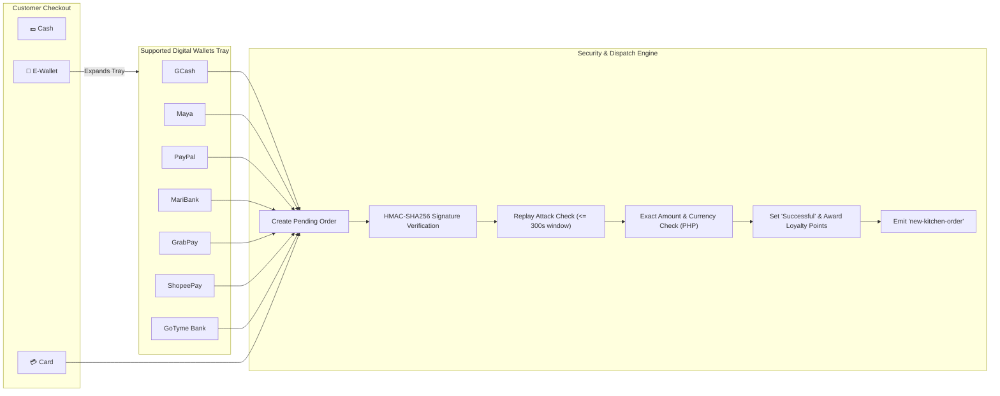
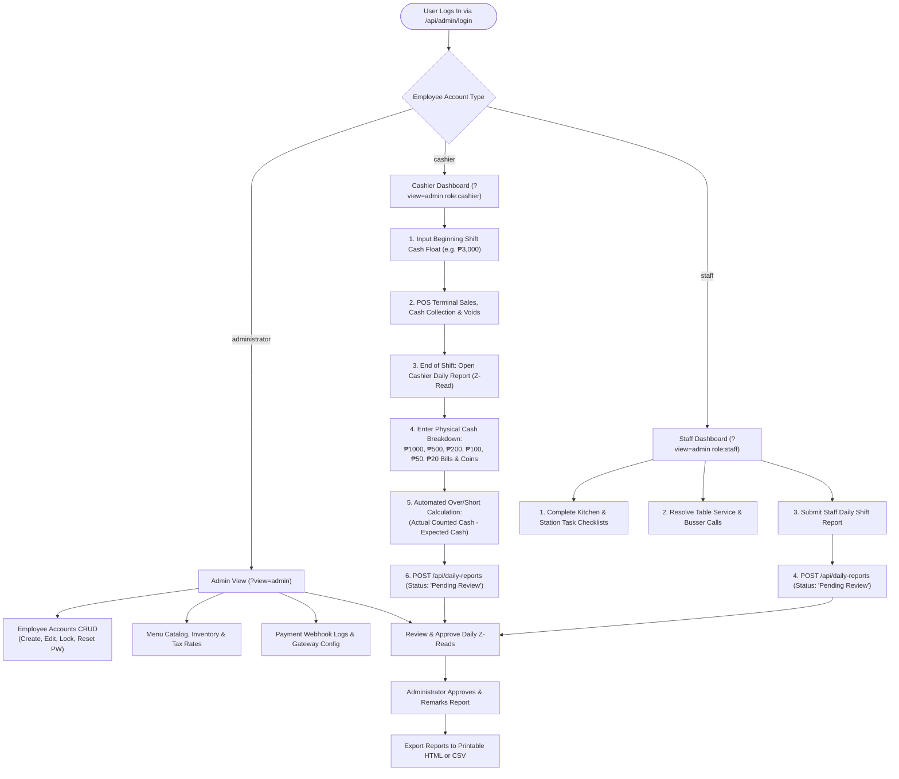

# Umami Craft Fusion 🥢
### Enterprise Restaurant Management, Real-Time Sync & Self-Service Dining System

**Umami Craft Fusion** is a full-stack, enterprise-grade restaurant management and omnichannel dining ecosystem. It seamlessly bridges customer-facing self-service kiosks, dynamic QR-code mobile ordering with privacy-first dietary safety checking, automated cryptographic webhook payment processing, a live kitchen display system (KDS), table service assistance, role-based employee administration (Admin, Cashier POS, and Kitchen Staff), and automated daily shift reporting with denomination-accurate cashier Z-reads.

---

## 📑 Table of Contents
1. [System Architecture & Network Topology](#-system-architecture--network-topology)
2. [End-to-End System Flowcharts](#-end-to-end-system-flowcharts)
   - [A. Omnichannel Ordering & Dietary Safety Flow](#a-omnichannel-ordering--dietary-safety-flow)
   - [B. Dynamic Wi-Fi & LAN IP Resolution Flow](#b-dynamic-wi-fi--lan-ip-resolution-flow)
   - [C. Payment Method & E-Wallet Sub-Selection Flow](#c-payment-method--e-wallet-sub-selection-flow)
   - [D. Employee Lifecycle, POS Shifts & Daily Reports Flow](#d-employee-lifecycle-pos-shifts--daily-reports-flow)
3. [Entity-Relationship Diagram (ERD)](#-entity-relationship-diagram-erd)
4. [Core Features & Modules](#-core-features--modules)
   - [1. Commercial Self-Service Touchscreen Kiosk](#1-commercial-self-service-touchscreen-kiosk)
   - [2. Dynamic Wi-Fi Connection & QR Code Generation](#2-dynamic-wi-fi-connection--qr-code-generation)
   - [3. Customer Allergy Verification & Local Dietary Vault](#3-customer-allergy-verification--local-dietary-vault)
   - [4. Payment Gateway Engine & E-Wallet Sub-Selection](#4-payment-gateway-engine--e-wallet-sub-selection)
   - [5. Real-Time Kitchen Display System (KDS) & Buzzer Alerts](#5-real-time-kitchen-display-system-kds--buzzer-alerts)
   - [6. Table Service Assistance & Busser Operations](#6-table-service-assistance--busser-operations)
   - [7. Role-Based Portals: Admin, Cashier POS, & Staff](#7-role-based-portals-admin-cashier-pos--staff)
   - [8. Daily Reports Management (Cashier Z-Reads & Staff Shifts)](#8-daily-reports-management-cashier-z-reads--staff-shifts)
   - [9. Security, Audit Trail & Forensic Logging](#9-security-audit-trail--forensic-logging)
5. [Database Architecture & File Structure](#-database-architecture--file-structure)
6. [API Reference & Socket.IO Real-Time Events](#-api-reference--socketio-real-time-events)
   - [REST Endpoints](#rest-endpoints)
   - [Socket.IO Events Matrix](#socketio-events-matrix)
7. [Installation & Getting Started](#-installation--getting-started)
8. [Multi-Restaurant Tenant Configuration](#-multi-restaurant-tenant-configuration)
9. [License](#-license)

---

## 🏛 System Architecture & Network Topology

The platform runs on a dual-server synchronized architecture bound to `0.0.0.0` for ubiquitous local network and mobile access:
- **Frontend Presentation Layer (`Vite` / React 19 on Port 3000):** Delivers the Touchscreen Kiosk, Customer Mobile Web App, Kitchen Display System (KDS), Cashier POS, and Executive Admin Panel.
- **Backend Application Layer (`Node.js` / Express / Socket.IO on Port 3001):** Manages state persistence, real-time ticket dispatch, dynamic IP discovery, Windows firewall automation, and HMAC-SHA256 webhook validation.

```
                      ┌───────────────────────────────────────────────────────────┐
                      │              CLIENT APPLICATIONS & VIEWPORTS              │
                      └───────┬───────────────────────────┬───────────────────┬───┘
                              │                           │                   │
             ┌────────────────▼─────────────┐ ┌───────────▼─────────────┐ ┌───▼───────────────────────────┐
             │ Kiosk & Mobile Ordering App  │ │ Staff & Cashier Portals │ │   Executive Administrator     │
             │ (?view=kiosk, ?view=mobile)  │ │ (POS, Prep, Tasks, Z-Rd)│ │ (Accounts, Reports, Webhooks) │
             └────────────────┬─────────────┘ └───────────┬─────────────┘ └───┬───────────────────────────┘
                              │                           │                   │
                              └───────────────────────────┼───────────────────┘
                                                          │ HTTP / REST / WebSocket (Port 3000 / 3001)
                                              ┌───────────▼─────────────┐
                                              │      Node.js Server     │
                                              │       (server.js)       │
                                              └─────┬───────┬───────┬───┘
                                                    │       │       │
                     ┌──────────────────────────────┘       │       └─────────────────────────────┐
                     │                                      │                                     │
         ┌───────────▼────────────┐            ┌────────────▼───────────┐            ┌────────────▼───────────┐
         │ HMAC-SHA256 Webhooks   │            │   Socket.IO Gateway    │            │   File Storage Layer   │
         │ (PayMongo/Maya/GCash)  │            │ (Live Tickets, Buzzer) │            │  (/data/*.json DB)     │
         └────────────────────────┘            └────────────────────────┘            └────────────────────────┘
```

---

## 🔄 End-to-End System Flowcharts

### A. Omnichannel Ordering & Dietary Safety Flow

The entire customer journey from terminal arrival to pickup:

```mermaid
flowchart TD
    Start([Customer Arrives]) --> ChannelChoice{Ordering Channel}

    %% Kiosk Flow
    ChannelChoice -->|Touchscreen Kiosk| KioskWelcome["Step 1: Kiosk Welcome Screen (?view=kiosk)"]
    KioskWelcome --> SelectDining["Select Dining Option: Dine-In or Takeout"]
    SelectDining --> KioskCatalog["Step 2: Browse Menu Categories & Combos"]

    %% Mobile QR Flow
    ChannelChoice -->|Mobile Phone| ScanQR["Scan Dynamic Kiosk QR Code"]
    ScanQR --> ConnectCheck{"Phone on Same Wi-Fi?"}
    ConnectCheck -->|No / Mobile Data On| ErrUnreachable["ERR_ADDRESS_UNREACHABLE<br/>(Turn off cellular data or switch to Cloud Tunnel)"]
    ConnectCheck -->|Yes| ValidateSession["POST /api/qr/validate (Scoped Session)"]

    %% Step 1: Mandatory Allergy Verification Page
    ValidateSession --> AllergyQuestion["Step 1: 'Do You Have Any Food Allergies?' Page<br/>(Clean Centered Card, Shield Icon & Session Pill)"]
    AllergyQuestion -->|NO, I DON'T HAVE ALLERGIES| SkipToFlavors["Path A: Skip Exclude Allergens<br/>(Records 'no_allergies_declared' & routes directly to Flavors)"]
    AllergyQuestion -->|YES, I HAVE ALLERGIES| OpenAllergensPage["Path B: Step 2: Dedicated Exclude Allergens Page<br/>(9 Major Allergens + Custom Allergen Input)"]

    %% Step 2: Dedicated Exclude Allergens Page
    OpenAllergensPage --> SelectStandardAllergens["Check Allergens to Exclude<br/>(Peanuts, Gluten, Dairy, Soy, Shellfish, Eggs, Fish, Tree Nuts, Sesame)"]
    SelectStandardAllergens --> AddCustomAllergens["Type Custom Exclusions (+ Add Tag Chips)"]
    AddCustomAllergens --> ContinueToFlavors["Click 'Continue to Flavor Preferences ›'<br/>(or '← Back to Allergy Question')"]
    ContinueToFlavors --> OpenFlavorsPage["Step 3: Dedicated Flavor Preferences Page"]
    SkipToFlavors --> OpenFlavorsPage

    %% Step 3: Dedicated Flavor Preferences Page
    OpenFlavorsPage --> SelectFlavors["Choose Flavor Preferences<br/>(Spicy, Vegan, Sweet, Savory, Healthy, Citrus, Crispy, Smoky)"]
    SelectFlavors --> FlavorBackOption["Contextual Back Button<br/>(Returns to Allergens if Path B, or Question if Path A without losing data)"]
    SelectFlavors --> StaffNotice["Review Staff Cross-Contact & Kitchen Safety Notice"]
    StaffNotice --> SaveVault["Click 'Continue to Menu ›'<br/>(Encrypted to LocalStorage & Scoped QR Session)"]

    %% Step 4: Filtered Safe Catalog
    SaveVault --> SafeCatalog["Step 4: Browse Filtered Menu Catalog (Filtered Dishes & Badges)"]
    KioskCatalog --> SafeCatalog

    %% Product Details & Allergen Guard
    SafeCatalog --> ClickProduct["Select Dish to View Details"]
    ClickProduct --> OpenProductModal["Open Product Details Modal"]
    OpenProductModal --> AllergenCheck{"Does Dish Contain<br/>Customer's Declared Allergens?"}
    AllergenCheck -->|Yes| WarningBanner["Display Red Warning Alert:<br/>'Contains Declared Allergen'"]
    AllergenCheck -->|No| SafeBadge["Display Verified Safe Tag"]
    WarningBanner --> CustomizeDish["Choose Size, Spice Level, Add-Ons & Notes"]
    SafeBadge --> CustomizeDish
    CustomizeDish --> AddToCart["Add to Cart & Update Live Cart Badge"]

    %% Checkout & Payment Method Selection
    AddToCart --> ReviewCart["Open Kiosk Checkout Modal"]
    ReviewCart --> ValidatePromo["Validate Promo Code (e.g. UMAMI20)"]
    ValidatePromo --> SelectPayMethod{"Select Payment Method"}

    SelectPayMethod -->|Cash| SelectCash["Cash at Front Counter POS"]
    SelectPayMethod -->|Card| SelectCard["Credit / Debit Card Terminal"]
    SelectPayMethod -->|E-Wallet| OpenEWalletTray["Expand E-Wallet Options Tray<br/>(GCash, Maya, PayPal, MariBank, GrabPay, ShopeePay, GoTyme)"]
    OpenEWalletTray --> ChooseSpecificWallet["Select Specific Wallet (Active Green Border)"]

    %% Payment Fulfillment
    SelectCash --> SubmitCashOrder["Order Created (paymentStatus: 'Pending Counter')"]
    SubmitCashOrder --> CashierPOS["Head Cashier Receives Cash & Validates"]
    CashierPOS --> MarkCashPaid["Cashier Marks 'Paid' in POS"]

    ChooseSpecificWallet --> SubmitDigitalOrder["Order Created (paymentStatus: 'Pending')"]
    SelectCard --> SubmitDigitalOrder
    SubmitDigitalOrder --> GatewayWebhook["Gateway Webhook Call (POST /api/webhooks/payment)"]
    GatewayWebhook --> HMACVerification{"HMAC-SHA256 & Amount Match?"}
    HMACVerification -->|Invalid| RejectPayment["Reject 401/422 & Flag Audit Log"]
    HMACVerification -->|Valid| ApprovePayment["Set paymentStatus: 'Successful'<br/>Credit 10% Loyalty Points"]

    %% Kitchen Dispatch & Fulfillment
    MarkCashPaid --> DispatchKitchen["Socket.IO: 'new-kitchen-order'"]
    ApprovePayment --> DispatchKitchen

    DispatchKitchen --> KDSView["Kitchen Display System (KDS) View"]
    KDSView --> ChefPreparing["Chef Starts Preparation (Status: 'Preparing')"]
    ChefPreparing --> ChefReady["Chef Marks 'Ready for Pickup'"]
    ChefReady --> BuzzerAlert["Trigger Web Audio 4-Note Chime<br/>& Mobile Hardware Vibration"]
    BuzzerAlert --> BusserHandover["Busser Delivers to Table / Pickup Counter"]
    BusserHandover --> CompleteOrder["Order Marked 'Completed'"]
```



---

### B. Dynamic Wi-Fi & LAN IP Resolution Flow

How the system detects the computer's live IPv4 address across changing Wi-Fi networks and routers without hardcoding:


---

### C. Payment Method & E-Wallet Sub-Selection Flow



---

### D. Employee Lifecycle, POS Shifts & Daily Reports Flow



---

## 🗄 Entity-Relationship Diagram (ERD)

The system maintains a relational-style entity schema stored in the persistent JSON storage layer with foreign keys and cascade validations:

```mermaid
erDiagram
    EMPLOYEE ||--o{ DAILY_REPORT : submits
    EMPLOYEE ||--o{ STAFF_TASK : assigned_to
    EMPLOYEE ||--o{ AUDIT_LOG : generates
    DAILY_REPORT ||--o{ DENOMINATION_BREAKDOWN : contains
    CUSTOMER ||--o{ ORDER : places
    CUSTOMER ||--o{ QR_SESSION : owns
    ORDER ||--|{ ORDER_ITEM : contains
    ORDER ||--o{ PAYMENT_WEBHOOK : verified_by
    MENU_ITEM ||--o{ ORDER_ITEM : references
    MENU_ITEM ||--|{ INGREDIENT : contains
    CATEGORY ||--o{ MENU_ITEM : categorizes
    PROMOTION ||--o{ ORDER : applies_to
    TABLE ||--o{ SERVICE_REQUEST : creates
    TABLE ||--o{ ORDER : assigned_to

    EMPLOYEE {
        string id PK "EMP-001"
        string username "admin / maria.cashier / kitchen"
        string name "Full Legal Name"
        string email "email@umamicraft.com"
        string accountType "admin | cashier | staff"
        string role "Super Admin | Head Cashier | Kitchen Staff"
        string status "Active | Inactive"
        string password "Hashed / Salted"
        string registerId "POS-01 (Front Counter)"
        float openingFloat "Beginning shift cash float"
        string shift "Morning | Evening | Mid | Full Day"
        string contactInfo "Mobile phone number"
        string department "Executive / Front Counter / Kitchen"
        string lastLogin "ISO Timestamp"
    }

    CUSTOMER {
        string id PK "CUST-101"
        string name "Juan Dela Cruz"
        string email "customer@email.com"
        string membershipTier "Gold Gourmet Club | Silver | Bronze"
        int pointsBalance "Loyalty Points Balance"
        float lifetimeSpend "Total Spend to Date"
        string status "Active | Suspended"
    }

    QR_SESSION {
        string sessionId PK "QRS-W54ESK-1794511"
        string kioskId "W54ESK"
        string restaurantId "umami"
        string tableNumber "Table 04 / Counter"
        string allergyStatus "unanswered | allergies_declared | no_allergies_declared"
        boolean hasAllergies "true | false"
        string_array allergens "Declared standard allergens"
        string_array customAllergens "Customer typed exclusions"
        string_array preferences "Flavor preferences tags"
        timestamp expiresAt "4-hour expiration TTL"
    }

    MENU_ITEM {
        string id PK "101"
        string sku "APP-001"
        string name "Spicy Szechuan Dumplings"
        string category "Appetizers"
        float price "380.00"
        float promoPrice "320.00"
        boolean available "true | false"
        int stock "Current inventory count"
        string_array allergens "soy, gluten, sesame"
        string_array tags "spicy, savory, recommended"
        string prepTime "10 mins"
        string description "Handmade pork dumplings tossed in fiery Sichuan chili crisp"
        string ingredients "Ground pork, chili oil, scallions, soy"
    }

    INGREDIENT {
        string name "Ground Pork"
        string quantity "180"
        string unit "g"
    }

    CATEGORY {
        string id PK "cat_appetizers"
        string name "Appetizers"
        string icon "🥟"
        int displayOrder "1"
    }

    ORDER {
        string orderId PK "ORD-20261113-001"
        string customer "Guest / Customer Name"
        string customerId "CUSTOMER FK"
        string diningOption "Dine-In | Takeout"
        string tableNumber "Table 04 / Takeout Counter"
        string kioskId "W54ESK | MOBILE_01"
        string status "Pending Payment | New | Preparing | Ready for Pickup | Completed"
        string payment "Cash | E-Wallet | Card"
        string eWalletProvider "GCash | Maya | PayPal | MariBank | GrabPay | ShopeePay | GoTyme"
        string paymentStatus "Pending | Pending Counter | Successful | Refunded | Voided"
        float subtotal "Subtotal before tax"
        float taxAmount "Tax amount (12% VAT)"
        float serviceCharge "Optional service charge"
        float discountAmount "Applied promo discount"
        float totalPrice "Final Order Amount (PHP)"
        string promoCode "UMAMI20"
        string_array allergens "Customer excluded allergens"
        timestamp createdAt "Order creation timestamp"
        timestamp paidAt "Payment verification timestamp"
    }

    ORDER_ITEM {
        string id "Item Cart ID"
        string originalId "MENU_ITEM FK"
        string name "Item Name with Size Modifier"
        int quantity "Item Quantity"
        float price "Unit Price in PHP"
        string size "Standard | Large | Bowl"
        string spiceLevel "Mild | Medium | Extra Spicy"
        string specialNote "No Onions • Chili Oil on Side"
    }

    PAYMENT_WEBHOOK {
        string eventId PK "evt_paymongo_xxxx"
        string gateway "paymongo | stripe | maya | gcash"
        string orderId "ORDER FK"
        float amount "Transaction Amount in PHP"
        string currency "PHP"
        string signatureStatus "Verified (HMAC-SHA256) | Invalid"
        string paymentStatus "Successful | Pending | Failed"
        boolean serviceActivated "Kitchen ticket & points dispatched"
        timestamp processedAt "ISO Timestamp"
    }

    DAILY_REPORT {
        string id PK "DLR-CSH-20261113-001"
        string reportType "cashier | staff"
        string employeeId "EMPLOYEE FK"
        string employeeName "Maria Santos"
        string role "Head Cashier"
        string shiftDate "YYYY-MM-DD"
        string registerId "POS-01 (Front Counter)"
        float beginningCash "Opening float (e.g. ₱3,000)"
        float totalGrossSales "Gross revenue"
        float totalNetSales "Net sales after discounts"
        float cashSales "Total physical cash received"
        float digitalSales "Total digital / e-wallet sales"
        float cardSales "Total card transactions"
        float actualCashCount "Closing counted physical cash"
        float cashOverShort "Discrepancy (Counted - Expected)"
        int totalTransactions "Count of completed orders"
        string reviewStatus "Pending Review | Reviewed | Approved"
        string adminRemarks "Executive notes"
    }

    DENOMINATION_BREAKDOWN {
        int bill1000 "Count of ₱1000 bills"
        int bill500 "Count of ₱500 bills"
        int bill200 "Count of ₱200 bills"
        int bill100 "Count of ₱100 bills"
        int bill50 "Count of ₱50 bills"
        int bill20 "Count of ₱20 bills"
        float coinsTotal "Total value of coins"
    }

    STAFF_TASK {
        string id PK "TSK-001"
        string employeeId "EMPLOYEE FK"
        string title "Sanitize Stations"
        string status "Pending | In Progress | Completed"
        string priority "High | Normal | Low"
    }

    SERVICE_REQUEST {
        string id PK "SRV-001"
        string tableNumber "Table 04"
        string type "Call Server | Water Refill | Utensils | Bill"
        string status "Active | In Progress | Resolved"
        timestamp createdAt "ISO Timestamp"
    }

    AUDIT_LOG {
        string id PK "LOG-20261113-001"
        string actorId "EMPLOYEE FK"
        string actorName "Chief Administrator"
        string category "Authentication | Webhook | Menu | Report | Security"
        string action "Specific action executed"
        string details "Detailed audit message"
        string ipAddress "Host / Client IP"
        timestamp timestamp "ISO Timestamp"
    }
```



---

## 🚀 Core Features & Modules

### 1. Commercial Self-Service Touchscreen Kiosk
- **Fast-Food Kiosk Flow (McDonald's / Jollibee / Chowking Inspired):**
  - **Step 1 – Welcome & Dining Selection:** Full-screen hero visual with **Dine-In • Start Order** and **Takeout • Start Order** buttons.
  - **Step 2 – Category Navigation:** Left-hand / top-nav category pills (Appetizers, Bowls & Mains, Dim Sum & Bites, Noodles, Drinks & Boba, Combos, Mix & Match) with quick filtering and sticky navigation.
  - **Step 3 – Rich Product Displays:** Visual product cards with high-resolution imagery, pricing, calorie/portion details, tags (*Spicy*, *Savory*, *Special Promo*), and verified allergen badges.
  - **Step 4 – Interactive Product Customizer (`<KioskProductModal />`):** Full dish description, ingredient composition list, size modifiers, spice sliders, and special instructions. Cross-checks ingredients against active customer dietary restrictions with an unmistakable safety banner.
  - **Step 5 – Touchscreen Checkout (`<KioskCheckoutModal />`):** Streamlined 2-step checkout with dining option confirmation, table number entry, promo code validator, and comprehensive payment method selection.

### 2. Dynamic Wi-Fi Connection & QR Code Generation
- **Zero Hardcoded IP Addresses:** Solves `ERR_ADDRESS_UNREACHABLE` dynamically by eliminating hardcoded references (`192.168.1.59`, `192.168.1.18`, `192.168.1.16`).
- **Kernel Routing Table Probe:** Node.js executes UDP probes against multiple targets (`1.1.1.1`, `8.8.8.8`, `192.168.1.1`) to reliably identify the primary gateway interface without sending external packets.
- **WLAN Interface Discovery:** Leverages `netsh wlan show interfaces` on Windows to read the active SSID, band (5 GHz / 2.4 GHz), and signal strength.
- **Automatic QR Regeneration:** Automatically refreshes the QR code URL whenever the host moves to a different router, house, or restaurant location:
  ```
  http://<CURRENT_HOST_IP>:3000/?view=mobile&kioskId=<kioskId>&kioskPort=3001&restaurant=umami
  ```
- **Windows Firewall Automation:** Server startup automatically ensures inbound TCP traffic on ports 3000–3020 is allowed on any network profile. A one-click repair endpoint (`POST /api/network/fix-firewall`) and [allow-firewall.bat](file:///c:/Users/USER/allergicSuggestion/allow-firewall.bat) are provided for non-elevated instances.
- **Universal Cloud Tunnel Backup:** Built-in toggle to switch to **"Any-Wi-Fi (Cloud Tunnel)"** if router AP Client Isolation is active.

### 3. Customer Allergy Verification & Local Dietary Vault
- **Strictly Separated Multi-Step Flow (Allergen & Flavor Preferences Never Co-exist on the Same Page):**
  - **Step 1 – Initial Food Allergy Selection Page:**
    - High-conversion, centered white card matching the official Umami Craft Fusion design.
    - Features the green restaurant/kiosk identifier pill (`🛡️ Umami Craft Fusion • Kiosk #...`), centered warm orange shield icon, and clear typography: **"Do You Have Any Food Allergies?"**
    - **Option A (YES, I HAVE ALLERGIES):** Navigates directly to Step 2 (Dedicated Exclude Allergens page).
    - **Option B (NO, I DON'T HAVE ALLERGIES):** Skips Step 2 completely, records `"no_allergies_declared"` in session/localStorage, and routes directly to Step 3 (Dedicated Flavor Preferences page).
  - **Step 2 – Dedicated Exclude Allergens Page (Single Focused Card):**
    - Exclusively dedicated to allergens; **Flavor Preferences are completely hidden** to eliminate cognitive overload.
    - Full-width, touch-friendly rows for all 9 major FDA/FALCPA allergens (Peanuts, Gluten/Wheat, Dairy, Soy, Shellfish, Eggs, Fish, Tree Nuts, Sesame) with custom icons and clear checkboxes.
    - **Custom Allergen Input:** Freeform entry for additional exclusions (e.g. MSG, Mustard, Kiwi, Celery) with `+ Add` button and removable tag chips.
    - **Navigation:** Primary **"Continue to Flavor Preferences ›"** button, plus a neutral **"← Back to Allergy Question"** button that preserves all customer selections.
  - **Step 3 – Dedicated Flavor Preferences Page (Single Focused Card):**
    - Exclusively dedicated to taste profiles; **Exclude Allergens is completely hidden**.
    - Full-width touch-friendly rows for desired culinary characteristics (Spicy, Vegan, Sweet, Savory, Healthy, Citrus & Tangy, Crispy Crunch, Smoky & Charred).
    - **Taste Profile Insights:** Auto-detects ordering patterns from recent visits to suggest matching profiles.
    - **Staff Safety Notice:** Explains that flavor preferences customize recommendations and reminds diners to confirm severe cross-contact risks with kitchen staff.
    - **Navigation:** Primary **"Continue to Menu ›"** button, plus a contextual **"← Back"** button (intelligently returns to *Exclude Allergens* if the customer chose Path B, or returns to the *Allergy Question* if they chose Path A, without losing data).
  - **Step 4 – Menu & Ordering Interface:**
    - Displays only verified-safe menu options or marks offending dishes with prominent safety alerts.
    - Includes an **"Edit Diet"** header button that allows diners to modify their allergies or flavors at any time during their dining session.
  - **Privacy Guarantee:** All dietary data persists strictly in client `localStorage` and binds temporarily to the scoped session token, preventing data leakage across different guests.

### 4. Payment Gateway Engine, Dynamic QR Ph & Card Checkout
- **Payment Method Hierarchy:**
  - **Cash:** Directs customer to pay at Front Counter POS (order status: `Pending Counter Cash Payment`).
  - **Card:** Opens dedicated, bank-grade checkout form with auto-formatted 16-digit card input, expiration validation (`MM/YY`), masked CVV, live card brand detection (**Visa**, **Mastercard**, **JCB**, **American Express**), and simulated bank **3D Secure 2.0 multi-factor OTP identity verification**. Zero raw PAN/CVVs stored.
  - **E-Wallet:** Expands an online digital wallet tray with individual logos and active green highlight states across 7 supported providers:
    - **GCash** (Popular)
    - **Maya** (QR Ph)
    - **PayPal** (Global)
    - **MariBank** (Digital Bank)
    - **GrabPay** (GrabRewards)
    - **ShopeePay** (Shopee App)
    - **GoTyme Bank** (Go Rewards)
- **Official Philippine QR Ph Standee Display:**
  - Exact pixel-perfect reproduction of the national **Bangko Sentral ng Pilipinas (BSP) QR Ph** standard standee:
    - Official stylized Philippine QR Ph logo + heavy bold **"SCAN NA ALL!"** headline + yellow **"NO FEES"** pill badge (`#FACC15`).
    - Centered white container card displaying merchant **`UMAMI CRAFT FUSION INC.`**.
    - Dynamically generated EMVCo-compliant QR code with the official QR Ph emblem embedded in the center.
    - Slogan: **"Basta kaya i-scan, pwede yan!"**.
    - Three colored app badges: **BANKS** (Blue `#0056B3`), **E-WALLETS** (Red `#DC2626`), **AND MORE** (Green `#16A34A`).
    - Payable amount banner (`₱...`), transaction reference (`TXN-UMAMI-...` with one-tap copy), live **10-minute expiration countdown timer**, and **"Simulate Customer Mobile App Payment"** action for rapid testing.
- **Mobile Kiosk QR Scanner (`<MobileQRScannerModal />`):**
  - Live rear camera viewfinder with camera permission handling and switch toggle.
  - High-tech scanning reticle with animated vertical laser line (`scanLaser`).
  - Torch / flashlight toggle control for low-light scanning.
  - Manual fallbacks: transaction code input and active local kiosk session auto-detection.
  - Dual-device vs. same-device mobile ordering: provides **"Pay via GCash / Maya App"** direct in-app authorization or **"Show QR for Companion"**.
- **Digital Itemized Receipt (`<DigitalReceiptModal />`):**
  - Displays upon successful payment with green checkmark banner, order ID (`#UM-XXXX`), and large **Pickup Token** (e.g. `U-108`).
  - Itemized dish breakdown, customizations, subtotal, 12% VAT inclusive calculation, promo discount, total paid, and pickup verification QR code.
  - Dispatches paid order directly to Kitchen Display System (KDS).
  - One-click **Print Receipt** (`window.print()`) and **Start New Order**.
- **Automated Webhook Engine:**
  - **Timing-Safe HMAC-SHA256 Signatures:** `crypto.timingSafeEqual` prevents side-channel timing attacks across `paymongo-signature`, `stripe-signature`, and custom headers.
  - **Replay Attack Defense:** 300-second maximum timestamp drift threshold.
  - **Idempotency Cache:** Prevents duplicate debits or duplicate kitchen ticket printing.
  - **Exact Centavo Matching:** Rejects payments where amount or currency diverges from database order totals.
  - **Loyalty Rewards:** Automatically credits 10% of total spend into the customer's account balance.

### 5. Real-Time Kitchen Display System (KDS) & Buzzer Alerts
- **Interactive Kitchen Board (`?view=kitchen`):** Grouped by status (*New*, *Preparing*, *Ready for Pickup*, *Completed*).
- **Allergen Highlighting:** Orders containing special dietary restrictions prominently flash red badges so chefs prioritize cross-contamination safeguards.
- **Audio Chime & Vibration:** Web Audio API triggers a crisp 4-note synthesized fanfare when an order is ready, alongside physical device vibration on customer mobile phones.

### 6. Table Service Assistance & Busser Operations
- **Table Service Modal (`<TableServiceModal />`):** Mobile diners can request server assistance (Napkins, Water Refill, Utensils, Bill Settlement, or General Assistance).
- **Busser View (`?view=busser`):** Real-time queue for bussers and floor runners to acknowledge and fulfill table requests and manage dining turnover.

### 7. Role-Based Portals: Admin, Cashier POS, & Staff
A unified authentication portal (`/api/admin/login`) validates credentials and securely routes actors based on account type:

| Role | Default Credentials | Viewport | Responsibilities |
| :--- | :--- | :--- | :--- |
| **Super Admin** | `admin` / `admin123` | `AdminView` | Employee accounts CRUD, menu editing, daily report approvals, payment webhook logs, and immutable security audit logs. |
| **Head Cashier** | `cashier.maria` / `cashier123` | `CashierDashboard` | Fast-paced touchscreen POS, beginning shift float entry, payment collection, voids/refunds, and Cashier Daily Z-Read submission. |
| **Kitchen Staff** | `kitchen@umamicraft.com` / `staff123` | `StaffDashboard` | Kitchen prep queue, station task checklists, table service calls, and Staff Daily Shift Report submission. |

### 8. Daily Reports Management (Cashier Z-Reads & Staff Shifts)
- **Cashier Daily Report (Z-Read):**
  - Calculates gross sales, discounts, refunds, voids, and net cash vs. digital payments.
  - **Denomination Breakdown Table:** Cashiers enter the exact count of physical bills (₱1000, ₱500, ₱200, ₱100, ₱50, ₱20) and coins.
  - Automated variance calculation:
    $$\text{Cash Over/Short} = \text{Actual Counted Cash} - \left(\text{Beginning Float} + \text{Net Cash Sales}\right)$$
- **Staff Daily Shift Report:** Records clock-in/out times, tasks completed, table calls handled, and incident remarks.
- **Executive Review & Export:** Administrators review, add administrative remarks, approve reports, and export to printable HTML or CSV formats.

### 9. Security, Audit Trail & Forensic Logging
- Immutable logging of every security-relevant action into `data/audit_logs.json` (logins, failed authentication, price updates, refunds, webhook signature rejections).
- Salted and hashed password security with protected API sanitization (passwords never returned in GET payloads).

---

## 💾 Database Architecture & File Structure

```
allergicSuggestion/
├── allow-firewall.bat           # Windows Defender Firewall auto-allow batch script
├── data/
│   ├── admin_auth.json          # Master administrator credentials
│   ├── audit_logs.json          # Immutable forensic security audit log
│   ├── categories.json          # Food and beverage category taxonomy
│   ├── customer_accounts.json   # Customer loyalty club memberships & point balances
│   ├── daily_reports.json       # Submitted Cashier Z-Reads & Staff Daily Reports
│   ├── drinks.json              # Drinks & Boba beverage catalog with size tiers
│   ├── employees.json           # Registered Admin, Cashier, and Staff employee accounts
│   ├── orders.json              # Comprehensive storewide active & completed orders
│   ├── payment_webhooks.json    # Cryptographic audit log of gateway webhook payloads
│   ├── preferences.json         # Dynamic allergen and flavor preference taxonomies
│   ├── promos.json              # Active promo discount codes and banners
│   ├── service_requests.json    # Live customer table assistance calls
│   ├── staff_tasks.json         # Operational shift checklists for staff members
│   └── menus/
│       ├── umami.json           # Umami Craft Fusion primary food catalog
│       ├── bella.json           # Bella Italia multi-tenant menu catalog
│       └── verde.json           # Verde Greens multi-tenant menu catalog
├── server.js                    # Express backend, Socket.IO hub & Webhook engine
├── vite.config.js               # Vite frontend configuration (bound to 0.0.0.0)
└── src/
    ├── App.jsx                  # Primary routing, role gatekeeper & modals
    ├── components/
    │   ├── AccessDeniedView.jsx     # Security lockout viewport for unauthorized roles
    │   ├── AdminLoginModal.jsx      # Unified role-based modal login
    │   ├── AdminSecurityModal.jsx   # Sensitive action PIN verification
    │   ├── AdminView.jsx            # Administrator command center
    │   ├── AllergyVerificationModal.jsx # Touchscreen allergy verification pop-up
    │   ├── BusserView.jsx           # Busser table turnover and service queue
    │   ├── CashierDashboard.jsx     # High-speed Cashier POS & Daily Report terminal
    │   ├── DailyReportsManager.jsx  # Admin Daily Shift Reports management & exports
    │   ├── EmployeeAccountManager.jsx # Role-based employee account administration
    │   ├── KioskCheckoutModal.jsx   # Touchscreen checkout & E-Wallet selector
    │   ├── KioskProductModal.jsx    # Dish details, ingredients list & safety alerts
    │   ├── KioskView.jsx            # Touchscreen Kiosk terminal & dynamic QR display
    │   ├── KitchenView.jsx          # Kitchen Display System (KDS) board
    │   ├── MobileView.jsx           # Customer mobile ordering & Local Dietary Vault
    │   ├── PaymentWebhookManager.jsx# Admin Webhook gateway monitor & simulator
    │   ├── StaffDashboard.jsx       # Staff preparation queue, tasks & daily reports
    │   └── TableServiceModal.jsx    # Table assistance & server summon modal
    └── utils/
        ├── preferencesService.js    # Allergen taxonomy sync service
        └── systemStore.js           # Client data cache, login helpers & audit logging
```

---

## 🔌 API Reference & Socket.IO Real-Time Events

### REST Endpoints

| Method | Endpoint | Description |
| :--- | :--- | :--- |
| `GET` | `/api/network-info` | Returns live active LAN IP, Wi-Fi SSID, signal strength, and ports. |
| `GET` | `/api/network/diagnostics` | Comprehensive adapter diagnostic report and QR routing URLs. |
| `POST`| `/api/network/fix-firewall` | Automatically applies Windows Defender Firewall allow rules for ports 3000–3020. |
| `POST`| `/api/qr/validate` | Validates scanned QR session, binds kiosk ID and restaurant configuration. |
| `POST`| `/api/qr/allergy-verification` | Records explicit YES/NO allergy response and stores excluded allergens. |
| `POST`| `/api/menu/check-allergens` | Cross-checks dish ingredients against customer declared allergens. |
| `POST`| `/api/webhooks/payment` | Universal automated payment gateway webhook endpoint (HMAC verified). |
| `POST`| `/api/webhooks/paymongo` | PayMongo webhook listener with replay attack protection. |
| `POST`| `/api/webhooks/simulate` | Webhook simulation testing harness. |
| `GET` | `/api/webhooks/logs` | Retrieves cryptographic webhook event audit logs. |
| `POST`| `/api/admin/login` | Unified role-based authentication (Admin, Cashier, Staff). |
| `GET` | `/api/employees` | Retrieves employee list (passwords omitted). |
| `POST`| `/api/employees` | Creates or updates an employee account. |
| `DELETE`| `/api/employees/:id` | Deactivates or removes an employee account. |
| `GET` | `/api/daily-reports` | Retrieves cashier Z-reads and staff daily reports. |
| `POST`| `/api/daily-reports` | Submits a new shift daily report with cash denomination breakdown. |
| `PUT` | `/api/daily-reports/:id` | Admin updates report status (*Approved* / *Reviewed*) with administrative remarks. |
| `GET` | `/api/orders` | Retrieves order history with optional filtering. |
| `POST`| `/api/orders` | Submits a new order to the system. |
| `PUT` | `/api/orders/:id/status` | Updates order lifecycle status (*Preparing*, *Ready*, *Completed*). |
| `GET` | `/api/customer-accounts` | Retrieves customer loyalty membership tiers and points balances. |
| `GET` | `/api/menu` | Retrieves menu products (supports `?restaurant=umami` scoping). |
| `GET` | `/api/restaurant` | Returns active restaurant metadata, LAN IP, and Wi-Fi state. |
| `POST`| `/api/payments/create-session` | Creates transaction-specific QR Ph / Card payment session with EMVCo payload. |
| `GET` | `/api/payments/session/:reference` | Queries live payment session status and expiration countdown. |
| `GET` | `/api/payments/active-sessions` | Lists active awaiting-payment sessions on the local network. |
| `POST`| `/api/payments/confirm-qr-scan` | Confirms mobile QR scan payment, settles order, and notifies kitchen. |
| `POST`| `/api/payments/process-card` | Securely authorizes debit/credit card payment via PayMongo 3DS gateway. |
| `POST`| `/api/payments/simulate` | Simulates payment settlement for rapid end-to-end testing. |
| `POST`| `/api/payments/cancel-session` | Cancels an active payment session. |

### Socket.IO Events Matrix

| Event Name | Direction | Payload | Description |
| :--- | :--- | :--- | :--- |
| `join-session` | Client → Server | `{ kioskId, role }` | Joins a scoped WebSocket room for live sync. |
| `network-ip-changed` | Server → Client | `{ ip, ssid, wifiConnected, signal }` | Broadcasts new LAN IP whenever the host changes Wi-Fi. |
| `place-order` | Client → Server | `{ order }` | Submits customer order for payment and kitchen routing. |
| `new-order` | Server → Client | `{ order }` | Broadcasts newly submitted order to dashboards. |
| `new-kitchen-order` | Server → Kitchen | `{ order }` | Dispatches confirmed, paid ticket to the kitchen display. |
| `order-status-updated`| Server → Client | `{ orderId, status }` | Real-time order progress update (*Preparing*, *Ready*, *Completed*). |
| `payment-session-created`| Server → Client | `{ referenceNumber, amount, walletId }` | Broadcasts new active payment session. |
| `payment-completed` | Server → Client | `{ referenceNumber, order, pickupToken }` | Real-time settlement broadcast updating kiosks and receipts. |
| `payment-webhook-received` | Server → Client | `{ eventId, gateway, status }` | Broadcasts verified webhook event to dashboards. |
| `service-request` | Client → Server | `{ tableNumber, type }` | Customer calls server for assistance. |
| `service-requests-updated` | Server → Staff | `{ requests }` | Synchronizes active table calls across staff terminals. |
| `daily-reports-updated` | Server → Admin | `{ reports }` | Real-time notification of newly submitted shift reports. |

---

## 🛠 Installation & Getting Started

### Prerequisites
- [Node.js](https://nodejs.org/) (v18.0.0 or higher recommended, tested on Node v24)
- npm (v9.0.0 or higher)

### Setup Instructions

1. **Clone or navigate to the repository:**
   ```bash
   cd allergicSuggestion
   ```

2. **Install project dependencies:**
   ```bash
   npm install
   ```

3. **Free up occupied ports (if ports 3000–3020 are in use):**
   ```bash
   npm run kill:ports
   ```

4. **Allow Windows Defender Firewall (Recommended on Windows):**
   Right-click `allow-firewall.bat` and select **"Run as administrator"**, or run:
   ```bash
   npm run allow-firewall
   ```

5. **Start Backend & Frontend in Development Mode:**
   ```bash
   npm run dev
   ```
   *Or run the dedicated Umami Craft Fusion instance:*
   ```bash
   npm run dev:umami
   ```

6. **Access the application in your browser:**
   - **Touchscreen Kiosk Display:** [http://localhost:3000/?view=kiosk](http://localhost:3000/?view=kiosk)
   - **Customer Mobile / QR Ordering:** [http://localhost:3000/?view=mobile](http://localhost:3000/?view=mobile)
   - **Kitchen Display System (KDS):** [http://localhost:3000/?view=kitchen](http://localhost:3000/?view=kitchen)
   - **Busser & Table Service View:** [http://localhost:3000/?view=busser](http://localhost:3000/?view=busser)
   - **Executive Administration Panel:** [http://localhost:3000/?view=admin](http://localhost:3000/?view=admin)

### Build & Quality Verification

Run the code linter:
```bash
npm run lint
```

Execute syntax validation and compile the production build:
```bash
npm test
```

---

## 🌐 Multi-Restaurant Tenant Configuration

The platform supports multi-tenant configurations with independent catalog data, branding, and port mappings:

| Restaurant Name | Identifier | Cuisine | Port Scope | Menu File |
| :--- | :--- | :--- | :--- | :--- |
| **Umami Craft Fusion** | `umami` | Asian Craft Fusion | `3000` / `3001` | `data/menus/umami.json` |
| **Bella Italia** | `bella` | Italian Trattoria | `3010` / `3002` | `data/menus/bella.json` |
| **Verde Greens** | `verde` | Plant-Based Healthy | `3020` / `3003` | `data/menus/verde.json` |

To spin up all restaurant instances concurrently:
```bash
npm run dev:suite
```

---

## 📜 License
Internal Enterprise Distribution — Designed and developed for **Umami Craft Fusion Restaurant Group**. All rights reserved.
