# Umami Craft Fusion 🥢
### Enterprise Restaurant Management, Real-Time Sync & Self-Service Dining System

**Umami Craft Fusion** is a full-stack, enterprise-grade restaurant management and omnichannel dining platform. It seamlessly bridges customer-facing self-service kiosks, dynamic QR-code mobile ordering, a cryptographic webhook payment gateway, kitchen display systems (KDS), role-based employee administration (Admin, Cashier POS, and Staff Operations), and automated daily shift reporting.

---

## 📑 Table of Contents
1. [System Architecture & Overview](#-system-architecture--overview)
2. [End-to-End System Flowchart](#-end-to-end-system-flowchart)
3. [Entity-Relationship Diagram (ERD)](#-entity-relationship-diagram-erd)
4. [Core Features & Modules](#-core-features--modules)
   - [1. Customer Touchscreen Kiosk & Dynamic QR Scan](#1-customer-touchscreen-kiosk--dynamic-qr-scan)
   - [2. Customer Allergy Verification & Local Dietary Vault](#2-customer-allergy-verification--local-dietary-vault)
   - [3. Automated Webhook-Based Payment Gateway Engine](#3-automated-webhook-based-payment-gateway-engine)
   - [4. Real-Time Kitchen Display System (KDS) & Table Service](#4-real-time-kitchen-display-system-kds--table-service)
   - [5. Role-Based Portals: Admin, Cashier POS, & Staff Operations](#5-role-based-portals-admin-cashier-pos--staff-operations)
   - [6. Daily Reports Management (Cashier & Staff Z-Reads)](#6-daily-reports-management-cashier--staff-z-reads)
   - [7. Centralized Audit Trail & Activity Logging](#7-centralized-audit-trail--activity-logging)
5. [Database Architecture & File Structure](#-database-architecture--file-structure)
6. [API Reference & Socket.IO Events](#-api-reference--socketio-events)
7. [Installation & Getting Started](#-installation--getting-started)
8. [Multi-Restaurant Environment](#-multi-restaurant-environment)

---

## 🏛 System Architecture & Overview

The platform uses a synchronized hybrid architecture with real-time bidirectional WebSocket communication (Socket.IO), Express REST APIs, cryptographic HMAC-SHA256 signature verification, and a persistent JSON database storage layer.

```
                      ┌───────────────────────────────────────────────────────────┐
                      │              CLIENT APPLICATIONS & VIEWPORTS              │
                      └───────┬───────────────────────────┬───────────────────┬───┘
                              │                           │                   │
             ┌────────────────▼─────────────┐ ┌───────────▼─────────────┐ ┌───▼───────────────────────────┐
             │ Kiosk & Mobile Ordering App  │ │ Staff & Cashier Portals │ │   Executive Administrator     │
             │ (?view=kiosk, ?view=mobile)  │ │ (POS, Prep, Tasks, Z-Rd)│ │ (Accounts, Reports, Webhooks) │
             └────────────────┬─────────────┘ └───────────┬─────────────┘ └───┬───────────────────────────┘
                              │                           │                   │
                              └───────────────────────────┼───────────────────┘
                                                          │ HTTP / REST / WebSocket (Port 3000 / 3001)
                                              ┌───────────▼─────────────┐
                                              │      Node.js Server     │
                                              │       (server.js)       │
                                              └─────┬───────┬───────┬───┘
                                                    │       │       │
                     ┌──────────────────────────────┘       │       └─────────────────────────────┐
                     │                                      │                                     │
         ┌───────────▼────────────┐            ┌────────────▼───────────┐            ┌────────────▼───────────┐
         │ HMAC-SHA256 Webhooks   │            │   Socket.IO Gateway    │            │   File Storage Layer   │
         │ (PayMongo/Maya/GCash)  │            │ (Live Tickets, Buzzer) │            │  (/data/*.json DB)     │
         └────────────────────────┘            └────────────────────────┘            └────────────────────────┘
```

---

## 🔄 End-to-End System Flowchart

The following flowchart illustrates the entire customer journey, payment gateway lifecycle, and kitchen fulfillment workflow:

```mermaid
flowchart TD
    %% Entry & QR
    Start([Customer Arrives]) --> KioskChoice{Entry Channel}
    KioskChoice -->|Kiosk Terminal| KioskScreen["View Kiosk Screen (?view=kiosk)"]
    KioskChoice -->|Mobile Scan| ScanQR["Scan Dynamic Wi-Fi QR Code"]

    ScanQR --> ValidateQR["POST /api/qr/validate (Scoped Session)"]
    KioskScreen --> KioskWelcome["Kiosk Welcome Screen (Dine-In / Takeout)"]

    %% Allergy Verification
    ValidateQR --> AllergyModal{"Allergy Prompt: Do you have allergies?"}
    AllergyModal -->|YES| OpenVault["Open Local Dietary Vault"]
    AllergyModal -->|NO| NoAllergy["Record 'No allergies declared'"]

    OpenVault --> SelectAllergens["Select Allergens (Standard + Custom Inputs)"]
    SelectAllergens --> SelectFlavors["Select Flavor Preferences"]
    SelectFlavors --> SaveDietary["POST /api/qr/allergy-verification (Saved to Session)"]

    NoAllergy --> CatalogView["Browse Menu Catalog (Auto-Filtered)"]
    SaveDietary --> CatalogView
    KioskWelcome --> CatalogView

    %% Product Selection & Customization
    CatalogView --> SelectItem["Select Menu Item"]
    SelectItem --> ProductModal["Open Product Customization Modal"]
    ProductModal --> CheckSafety{"Allergen Cross-Check"}
    CheckSafety -->|Contains Excluded Allergen| ShowWarning["Display Red Allergen Safety Alert"]
    CheckSafety -->|Allergen Free| SafeTag["Display Verified Safe Tag"]
    ShowWarning --> Customize["Choose Size, Spice Level, Add-Ons & Notes"]
    SafeTag --> Customize
    Customize --> AddToCart["Add to Cart & Update Cart Floating Bar"]

    %% Checkout & Payment
    AddToCart --> ReviewOrder["Open Kiosk Checkout Modal"]
    ReviewOrder --> ApplyPromo["Validate & Apply Promo Code"]
    ApplyPromo --> ChoosePayment{"Select Payment Method"}

    ChoosePayment -->|Cash at Counter| PlaceCashOrder["Place Order (paymentStatus: 'Pending Counter')"]
    ChoosePayment -->|GCash / Maya / Card| PlaceDigitalOrder["Place Order (paymentStatus: 'Pending')"]

    PlaceCashOrder --> CashierCounter["Cashier POS Register #1"]
    CashierCounter --> CashierCollect["Cashier Receives Cash & Marks Paid"]

    PlaceDigitalOrder --> GatewayWebhook["Payment Gateway Sends Webhook Event"]
    GatewayWebhook --> VerifySig{"Verify HMAC-SHA256 & Amount Match"}
    VerifySig -->|Invalid Signature / Mismatch| RejectPay["Reject Event (401/422) & Flag Fraud"]
    VerifySig -->|Valid Signature & Match| ApprovePay["Mark 'Successful' & Award Loyalty Points"]

    %% Kitchen Dispatch
    CashierCollect --> SendToKitchen["Emit 'new-kitchen-order'"]
    ApprovePay --> SendToKitchen

    SendToKitchen --> KitchenBoard["Kitchen Display System (KDS)"]
    KitchenBoard --> ChefPrep["Chef Prepares Meal (Status: 'Preparing')"]
    ChefPrep --> ChefReady["Chef Marks 'Ready for Pickup'"]
    ChefReady --> BuzzerChime["Trigger Customer Buzzer & 4-Note Chime"]
    BuzzerChime --> BusserServe["Busser Serves to Table / Counter Handover"]
    BusserServe --> OrderCompleted["Order Status: 'Completed'"]
```



---

## 🗄 Entity-Relationship Diagram (ERD)

The system maintains a relational-style entity structure stored and synchronized across JSON databases:

```mermaid
erDiagram
    EMPLOYEE ||--o{ DAILY_REPORT : submits
    EMPLOYEE ||--o{ STAFF_TASK : assigned_to
    EMPLOYEE ||--o{ AUDIT_LOG : generates
    CUSTOMER ||--o{ ORDER : places
    CUSTOMER ||--o{ QR_SESSION : owns
    ORDER ||--|{ ORDER_ITEM : contains
    ORDER ||--o{ PAYMENT_WEBHOOK : verified_by
    MENU_ITEM ||--o{ ORDER_ITEM : references
    MENU_ITEM ||--|{ INGREDIENT : contains
    CATEGORY ||--o{ MENU_ITEM : categorizes
    PROMOTION ||--o{ ORDER : applies_to

    EMPLOYEE {
        string id PK "EMP-001"
        string username "admin / maria.cashier / kitchen"
        string name "Full Name"
        string email "email@umamicraft.com"
        string accountType "admin | cashier | staff"
        string role "Super Admin | Head Cashier | Kitchen Staff"
        string status "Active | Inactive"
        string password "Stored Hashed / Salted"
        string registerId "POS-01 (Front Counter)"
        float openingFloat "Beginning shift cash"
        string shift "Morning | Evening | Mid"
        string lastLogin "ISO Timestamp"
    }

    CUSTOMER {
        string id PK "CUST-101"
        string name "Juan Dela Cruz"
        string email "customer@email.com"
        string membershipTier "Gold Gourmet Club"
        int pointsBalance "Loyalty Points"
        string status "Active | Suspended"
    }

    QR_SESSION {
        string sessionId PK "QRS-W54ESK-XXXX"
        string kioskId "W54ESK"
        string restaurantId "umami"
        string allergyStatus "unanswered | allergies_declared | no_allergies_declared"
        boolean hasAllergies "true | false"
        string_array allergens "Declared allergens"
        string_array customAllergens "User typed custom exclusions"
        string_array preferences "Flavor tags"
        timestamp expiresAt "4-hour TTL"
    }

    MENU_ITEM {
        string id PK "101"
        string sku "APP-001"
        string name "Spicy Szechuan Dumplings"
        string category "Appetizers"
        float price "380.00"
        float promoPrice "320.00"
        boolean available "true | false"
        int stock "Current inventory quantity"
        string_array allergens "soy, gluten"
        string_array tags "spicy, savory"
        string prepTime "10 mins"
        string ingredients "Ground pork, chili oil, soy"
    }

    INGREDIENT {
        string name "Ground Pork"
        string quantity "180"
        string unit "g"
    }

    ORDER {
        string orderId PK "ORD-1234"
        string customer "Customer Name / Guest"
        string diningOption "Dine-In | Takeout"
        string tableNumber "Table 1 / Counter"
        string kioskId "W54ESK | MOBILE_01"
        string status "Pending Payment | New | Preparing | Ready for Pickup | Completed"
        string payment "GCash | Maya | Card | Cash"
        string paymentStatus "Pending | Successful | Approved | Refunded | Voided"
        float totalPrice "Calculated Order Total"
        float discountAmount "Applied Promo Discount"
        string promoCode "UMAMI20"
        string_array allergens "Excluded customer allergens"
        timestamp createdAt "Order creation time"
    }

    ORDER_ITEM {
        string id "Item Cart ID"
        string originalId "MENU_ITEM FK"
        string name "Item Name with Size"
        int quantity "Item Qty"
        float price "Item Unit Price"
        string size "Standard | Large"
        string spiceLevel "Mild | Medium | Extra Spicy"
        string specialNote "No Onions • Sauce on Side"
    }

    PAYMENT_WEBHOOK {
        string eventId PK "evt_paymongo_xxxx"
        string gateway "paymongo | stripe | maya | gcash"
        string orderId "ORDER FK"
        float amount "Transaction Amount in PHP"
        string currency "PHP"
        string signatureStatus "Verified (HMAC-SHA256) | Invalid"
        string paymentStatus "Successful | Pending | Failed"
        boolean serviceActivated "Kitchen & points triggered"
        timestamp processedAt "ISO Timestamp"
    }

    DAILY_REPORT {
        string id PK "DLR-CSH-20261112-001"
        string reportType "cashier | staff"
        string employeeId "EMPLOYEE FK"
        string employeeName "Maria Santos"
        string role "Head Cashier"
        string shiftDate "YYYY-MM-DD"
        float beginningCash "Opening float"
        float actualCashCount "Closing counted cash"
        float cashOverShort "Overage or shortage"
        float totalGrossSales "Gross revenue"
        int totalTransactions "Count of sales"
        string reviewStatus "Pending Review | Reviewed | Approved"
    }

    STAFF_TASK {
        string id PK "TSK-001"
        string employeeId "EMPLOYEE FK"
        string title "Sanitize Stations"
        string status "Pending | In Progress | Completed"
        string priority "High | Normal | Low"
    }

    AUDIT_LOG {
        string id PK "LOG-XXXX"
        string actorId "EMPLOYEE FK"
        string actorName "Chief Administrator"
        string category "Authentication | Webhook | Menu | Report"
        string action "Specific action taken"
        string details "Descriptive audit text"
        timestamp timestamp "ISO Timestamp"
    }
```



---

## 🚀 Core Features & Modules

### 1. Customer Touchscreen Kiosk & Dynamic QR Scan
* **Touchscreen Kiosk View (`?view=kiosk`):** Clean and focused self-service terminal interface with high-contrast buttons, responsive layout, and active network diagnostics.
* **Dynamic Network & Wi-Fi Resolution:**
  - Automated Windows WLAN interface probe (`netsh wlan show interfaces`) coupled with `os.networkInterfaces()`.
  - Automatically renders the live active Wi-Fi IP address (e.g., `192.168.1.59:3000`) and SSID directly on the Kiosk QR code.
  - **Any-Wi-Fi (Cloud Tunnel) Fallback:** Integrated cloud tunnel switcher allowing customers on cellular data or outside networks to connect reliably.

### 2. Customer Allergy Verification & Local Dietary Vault
* **Mandatory Post-QR Scan Verification Modal:**
  - When scanning from mobile, customers are immediately prompted: **"Do You Have Any Food Allergies?"**
  - Requires explicit **YES** or **NO** selection.
  - Selecting **NO** records `"No allergies declared"` for the dining session.
  - Selecting **YES** directs the customer into the **Local Dietary Vault**.
* **Local Dietary Vault (`mvault-root`):**
  - **Section 1: Exclude Allergens:** Interactive multi-select checklists covering Peanuts, Gluten/Wheat, Dairy, Soy, Shellfish, Eggs, Fish, Tree Nuts, and Sesame.
  - **Custom Allergen Input:** Dynamic text input for custom exclusions (e.g. MSG, Mustard, Kiwi) with removable tag chips.
  - **Section 2: Flavor Preferences:** Independent flavor profile preferences (Spicy, Vegan, Sweet, Savory, Healthy, Citrus, Crispy, Smoky) kept strictly decoupled from medical allergies.
  - **Local Storage Privacy Vault:** Selections persist securely in client storage and link only to the active QR session without cross-customer session leakage.
* **Automated Catalog & Ingredient Checking:**
  - Dynamic filtering hides hazardous dishes from the safe catalog view.
  - In `<KioskProductModal />`, if a dish contains a customer's declared allergen, an alert banner is displayed.
  - Menu items without verified allergen data are labeled: *Allergen Info Unverified — Ask Server*.

### 3. Automated Webhook-Based Payment Gateway Engine
* **Zero Manual Verification Required:** Replaces manual cashier receipt reviews with real-time automated webhook callbacks from payment gateways (PayMongo, GCash, Maya, Stripe, Credit/Debit Card).
* **Security & Cryptography:**
  - **HMAC-SHA256 Signatures:** Timing-safe signature validation (`crypto.timingSafeEqual`) across multiple gateway headers (`x-signature`, `paymongo-signature`, `stripe-signature`).
  - **Replay Attack Defense:** Enforces a 300-second maximum timestamp drift window.
  - **Idempotency & Duplicate Protection:** Caches event IDs to prevent duplicate billing or repeated order dispatches.
  - **Exact Amount & Currency Matching:** Verifies that the gateway payload's amount and currency match order database records down to the centavo before updating status.
* **Auto-Dispatch to Kitchen:** Upon receiving a verified `Successful` webhook status, orders are updated to `New` and instantly routed to the Kitchen Display System (`new-kitchen-order`).
* **Automated Customer Account Rewards:** Automatically credits customer accounts with loyalty points (+10% of total spend) upon confirmed payment.

### 4. Real-Time Kitchen Display System (KDS) & Table Service
* **Live Ticket Flow:** Kitchen tickets display table numbers, items, sizes, spice levels, add-ons, special notes, and highlighted allergen tags.
* **Buzzer Fanfare & Audio Alerts:**
  - Synthesized 4-note ready fanfare chime (Web Audio API) when an order is marked *Ready for Pickup*.
  - Continuous hardware vibration alerts on customer mobile devices.
* **Table Service & Assistance Calls:** Integrated `<TableServiceModal />` allowing diners to summon servers for napkins, water, utensil refills, or bill settlement.

### 5. Role-Based Portals: Admin, Cashier POS, & Staff Operations
Unified authentication (`/api/admin/login`) automatically routes authenticated credentials to their dedicated portal:

| Role / Account Type | Default Credentials | Destination Interface | Permissions & Responsibilities |
| :--- | :--- | :--- | :--- |
| **Super Admin** | `admin` / `admin123` | **Admin Panel** (`AdminView`) | Full system access: Account CRUD, Daily Reports approval, Menu editing, Inventory, Payment Webhook Manager, and Audit Logs. |
| **Head Cashier** | `cashier.maria` / `cashier123` | **Cashier Dashboard** (`CashierDashboard`) | Fast touchscreen POS terminal, cash drawer float management, shift transactions, refund/void processing, and Cashier Daily Z-Read reports. |
| **Kitchen Staff** | `kitchen@umamicraft.com` / `staff123` | **Staff Dashboard** (`StaffDashboard`) | Live kitchen preparation queue, assigned station checklists, table service calls, and Staff Daily Shift Reports. |

### 6. Daily Reports Management (Cashier & Staff Z-Reads)
* **Cashier Daily Report (Z-Read):**
  - Shift summary tracking beginning cash float, total cash sales, digital gateway sales, discounts, refunds, and voided orders.
  - Cash denomination breakdown table (₱1000, ₱500, ₱200, ₱100, ₱50, ₱20) calculating expected vs. actual drawer count with automated cash overage or shortage calculations.
* **Staff Daily Report:**
  - Shift logging with time in/out, shift schedule, completed tasks count, table calls handled, and staff remarks.
* **Admin Review & Export:**
  - Executive review workflow allowing administrators to review, approve, add administrative remarks, and export reports to printable HTML or spreadsheet CSV formats.

### 7. Centralized Audit Trail & Activity Logging
Every security-sensitive event (successful logins, blocked deactivated account logins, price changes, refund authorizations, and webhook signature rejections) is written to `data/audit_logs.json` with actor metadata, IP address, and timestamp.

---

## 💾 Database Architecture & File Structure

All operational databases are stored under the `/data` directory:

```
allergicSuggestion/
├── data/
│   ├── admin_auth.json          # Salted hash credentials for primary administrator
│   ├── audit_logs.json          # Immutable security and authentication event log
│   ├── customer_accounts.json   # Customer loyalty club memberships & point balances
│   ├── daily_reports.json       # Submitted Cashier Z-Reads & Staff Daily Reports
│   ├── drinks.json              # Drinks, Boba, & beverage catalog with size tiers
│   ├── employees.json           # Registered Admin, Cashier, and Staff employee accounts
│   ├── orders.json              # Comprehensive storewide active & completed orders
│   ├── payment_webhooks.json    # Cryptographic audit log of gateway webhook payloads
│   ├── preferences.json         # Dynamic allergen and flavor preference taxonomies
│   ├── promos.json              # Discount codes, dates, and promotional banners
│   ├── service_requests.json    # Live customer table assistance calls
│   ├── staff_tasks.json         # Operational shift checklists for staff members
│   └── menus/
│       ├── umami.json           # Umami Craft Fusion primary food catalog
│       ├── bella.json           # Bella Italia multi-tenant menu catalog
│       └── verde.json           # Verde Greens multi-tenant menu catalog
├── server.js                    # Core Express backend, Socket.IO hub & Webhook engine
├── scripts/
│   └── kill-ports.js            # Cross-platform port clearing utility (IPv4 & IPv6)
└── src/
    ├── App.jsx                  # Primary routing, authentication gatekeeper & modals
    ├── components/
    │   ├── AdminView.jsx            # Administrator command center
    │   ├── AllergyVerificationModal.jsx # Touchscreen allergy verification pop-up
    │   ├── CashierDashboard.jsx     # High-speed Cashier POS & Daily Report terminal
    │   ├── DailyReportsManager.jsx  # Admin Daily Shift Reports management & exports
    │   ├── EmployeeAccountManager.jsx # Role-based employee account administration
    │   ├── KioskCheckoutModal.jsx   # 2-step touchscreen checkout & payment selector
    │   ├── KioskProductModal.jsx    # Item details, verified ingredients & add-on modal
    │   ├── KioskView.jsx            # Touchscreen Kiosk terminal & dynamic QR display
    │   ├── KitchenView.jsx          # Kitchen Display System (KDS) board
    │   ├── MobileView.jsx           # Customer mobile ordering & Local Dietary Vault
    │   ├── PaymentWebhookManager.jsx# Admin Webhook gateway monitor & testbed simulator
    │   ├── StaffDashboard.jsx       # Staff preparation queue, tasks & daily reports
    │   └── TableServiceModal.jsx    # Table assistance & server summon modal
    └── utils/
        ├── preferencesService.js    # Allergen taxonomy sync service
        └── systemStore.js           # Client data cache, login helpers & audit logging
```

---

## 🔌 API Reference & Socket.IO Events

### Key REST Endpoints

| Method | Endpoint | Description |
| :--- | :--- | :--- |
| `POST` | `/api/qr/validate` | Validates scanned QR session, binds kiosk ID and restaurant configuration. |
| `POST` | `/api/qr/allergy-verification` | Records explicit YES/NO allergy response and stores excluded allergens. |
| `POST` | `/api/menu/check-allergens` | Cross-checks item ingredients against customer declared allergens. |
| `POST` | `/api/webhooks/payment` | Universal automated payment gateway webhook endpoint (HMAC verified). |
| `POST` | `/api/webhooks/paymongo` | PayMongo webhook listener with replay attack protection. |
| `POST` | `/api/webhooks/simulate` | Developer & cashier simulation endpoint to test webhook workflows. |
| `GET` | `/api/webhooks/logs` | Retrieves cryptographic webhook event audit logs. |
| `POST` | `/api/admin/login` | Unified role-based authentication (Admin, Cashier, Staff). |
| `GET` | `/api/employees` | Retrieves employee list (passwords omitted). |
| `POST` | `/api/employees` | Creates or updates an employee account. |
| `GET` | `/api/daily-reports` | Retrieves filtered cashier and staff daily reports. |
| `POST` | `/api/daily-reports` | Submits a new shift daily report (Cashier Z-Read or Staff report). |
| `GET` | `/api/customer-accounts` | Retrieves customer membership tiers and loyalty points. |
| `GET` | `/api/menu` | Retrieves menu products (supports `?restaurant=umami` scoping). |
| `GET` | `/api/restaurant` | Returns active restaurant metadata, LAN IP, and Wi-Fi state. |

### Socket.IO Real-Time Events

| Channel / Event | Direction | Purpose |
| :--- | :--- | :--- |
| `join-session` | Client → Server | Client joins a room for a specific `kioskId` or staff role. |
| `place-order` | Client → Server | Customer submits order for payment and kitchen routing. |
| `new-order` | Server → Client | Broadcasts newly submitted order to dashboards. |
| `new-kitchen-order` | Server → Kitchen | Dispatches confirmed, paid ticket to kitchen display. |
| `order-status-updated`| Server → Client | Real-time order progress update (*Preparing*, *Ready*, *Completed*). |
| `payment-webhook-received` | Server → Client | Broadcasts verified webhook event to dashboards. |
| `service-request` | Client → Server | Diner calls server for table assistance. |
| `service-requests-updated` | Server → Staff | Synchronizes active table calls across staff terminals. |
| `daily-reports-updated` | Server → Dashboards | Real-time notification of newly submitted shift reports. |

---

## 🛠 Installation & Getting Started

### Prerequisites
- [Node.js](https://nodejs.org/) (v18.0.0 or higher recommended, tested on Node v24)
- npm (v9.0.0 or higher)

### Setup Instructions

1. **Clone or navigate to the repository:**
   ```bash
   cd allergicSuggestion
   ```

2. **Install project dependencies:**
   ```bash
   npm install
   ```

3. **Free up occupied ports (if ports 3000–3020 are in use):**
   ```bash
   npm run kill:ports
   ```

4. **Start Backend & Frontend in Development Mode:**
   ```bash
   npm run dev
   ```
   *Alternatively, start the Umami Craft Fusion specific suite:*
   ```bash
   npm run dev:umami
   ```

5. **Access the application in your browser:**
   - **Touchscreen Kiosk Display:** [http://localhost:3000/?view=kiosk](http://localhost:3000/?view=kiosk)
   - **Customer Mobile / QR Ordering:** [http://localhost:3000/?view=mobile](http://localhost:3000/?view=mobile)
   - **Kitchen Display System (KDS):** [http://localhost:3000/?view=kitchen](http://localhost:3000/?view=kitchen)
   - **Executive Administration Panel:** [http://localhost:3000/?view=admin](http://localhost:3000/?view=admin)

### Build & Quality Verification

Run the Oxlint code linter:
```bash
npm run lint
```

Execute syntax validation and compile the production build:
```bash
npm test
```

---

## 🌐 Multi-Restaurant Environment

The platform supports multi-tenant configurations with independent catalog data, branding, and port mappings:

| Restaurant Name | Identifier | Cuisine | Port Scope | Menu File |
| :--- | :--- | :--- | :--- | :--- |
| **Umami Craft Fusion** | `umami` | Asian Craft Fusion | `3000` / `3001` | `data/menus/umami.json` |
| **Bella Italia** | `bella` | Italian Trattoria | `3010` / `3002` | `data/menus/bella.json` |
| **Verde Greens** | `verde` | Plant-Based Healthy | `3020` / `3003` | `data/menus/verde.json` |

To spin up all restaurant instances concurrently:
```bash
npm run dev:suite
```

---

## 📜 License
Internal Enterprise Distribution — Designed and developed for **Umami Craft Fusion Restaurant Group**. All rights reserved.
